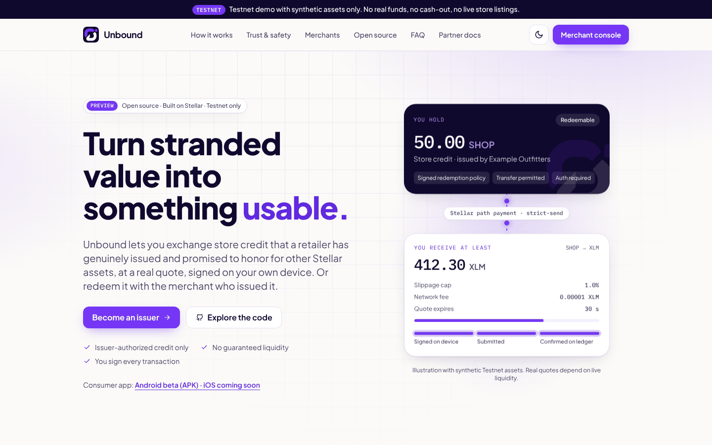
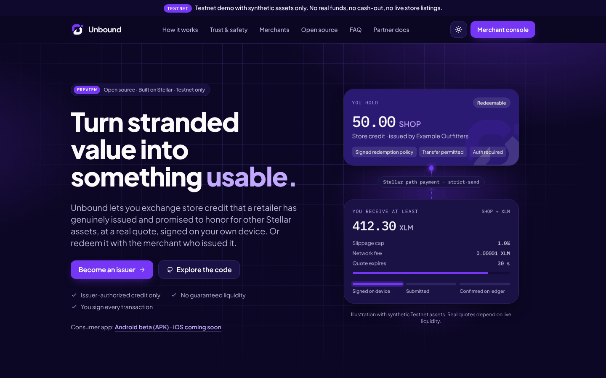
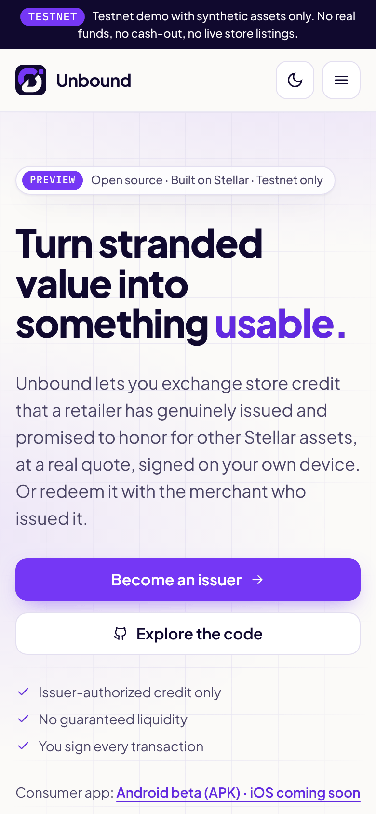
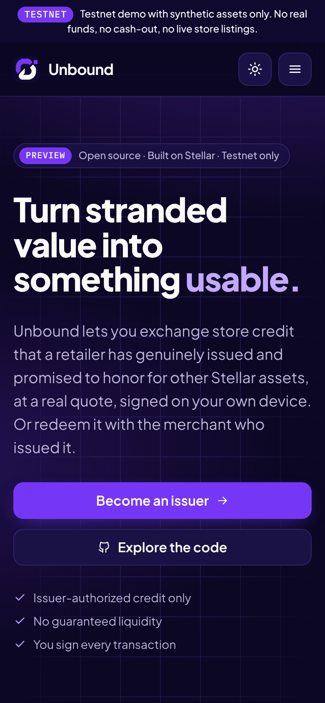
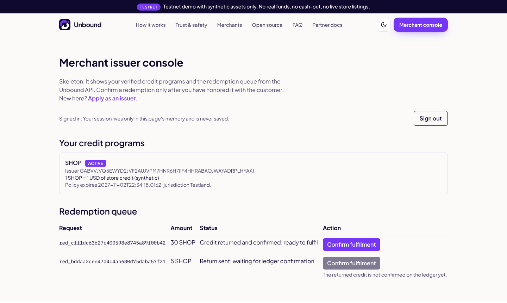
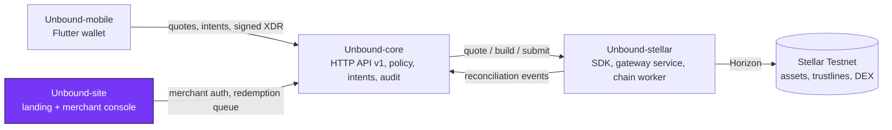

<div align="center">


# Unbound-site

**The public face of Unbound: the landing page, partner docs and the merchant console where issuers confirm redemptions.**

[](https://github.com/Unbound224/Unbound-site/actions/workflows/ci.yml)
[](./LICENSE)
[](https://developers.stellar.org/docs/networks)
[](#project-status)

Part of **[Unbound](https://github.com/Unbound224)** - turn stranded value into something usable.

</div>

<p align="center">
  
  
</p>

## What is Unbound?

Store credit is usually stuck inside one retailer. Unbound lets a person exchange store credit that a retailer has
**genuinely issued and agreed to honor** for other Stellar assets, at a real order-book quote that they sign on their
own device, or redeem it with the issuer.

- **Issuer-authorized only.** A verified merchant signs a redemption policy with its Stellar issuer key and must
  authorize every holder's trustline. No issuer, no usable credit; arbitrary gift cards are out of scope.
- **No fake liquidity.** Quotes come from real Stellar path payments, expire and carry a minimum-output floor. No route
  means no quote. Unbound never promises a price, liquidity or fiat cash-out.
- **Ledger-truthful.** Nothing is shown as settled until the ledger confirms it; unknown outcomes reconcile by hash.
- **Testnet only today.** Mainnet needs an external security review and legal/compliance work that has not happened.

## This repository

A Next.js app with two halves:

- **Landing** - value proposition, how it works (issuer -> credit -> exchange -> redemption), trust and safety,
  consumer app, merchants, the four repositories with an honest status table, FAQ. Light and dark themes, responsive
  down to 360 px, entrance animations that switch off under `prefers-reduced-motion`.
- **Merchant console** - sign in against `Unbound-core`, see verified credit programs and the redemption queue, and
  confirm fulfilment only once the returned credit is confirmed on the ledger. The session token lives in memory only.

It never builds or signs Stellar transactions and never asks for a secret key.

### Screenshots

Real captures of the production build (Playwright, Chromium). Full-page versions:
[light](./docs/screenshots/desktop-full-light.png) · [dark](./docs/screenshots/desktop-full-dark.png).

| Mobile (390 px), light | Mobile (390 px), dark | Merchant console (signed in to a locally seeded core) |
|---|---|---|
|  |  |  |

## Architecture

Unbound is four independently tested repositories with one owner per boundary. This one is highlighted.



Clients never build Stellar transactions, and core never reimplements ledger logic. Details:
[`docs/ARCHITECTURE.md`](./docs/ARCHITECTURE.md) and [`docs/STELLAR_PROTOCOL.md`](./docs/STELLAR_PROTOCOL.md).

## Quickstart

Requires Node 22+.

```bash
npm ci
cp .env.example .env.local         # NEXT_PUBLIC_API_URL=/core, CORE_PROXY_TARGET=http://127.0.0.1:3001
npm run dev                        # http://localhost:3000
npm run check                      # lint + typecheck + tests + production build
```

The landing page works on its own. For the merchant console, run a seeded
[Unbound-core](https://github.com/Unbound224/Unbound-core#quickstart) on port 3001 and sign in with the seeded merchant.
Core sends no CORS headers, so the browser talks to this site's `/core/*` route, which Next proxies to
`CORE_PROXY_TARGET`.

### Store badges (config-driven)

The mobile app is **not** in the App Store or Google Play. Official badges render only when
`NEXT_PUBLIC_APP_STORE_URL` / `NEXT_PUBLIC_PLAY_STORE_URL` are set at build time to https URLs on `apps.apple.com` /
`play.google.com`; the badge artwork is then loaded from Apple and Google, never redrawn. Without them the page shows
**Download for Android (beta APK)** linking to
[Unbound-mobile releases](https://github.com/Unbound224/Unbound-mobile/releases) and an inert **iOS - coming soon**.
A test asserts that no store links or badge images render without the env vars.

## Project status

Legend: **Built** = implemented and covered by automated tests in this repo. **Not yet** = not started or not verified.

| Area | Status |
|---|---|
| Landing page: all sections, light/dark, responsive to 360 px, reduced motion, config-driven store badges | Built |
| Sign-in / registration against core; token in memory only; sign-out revokes server-side | Built |
| Merchant application form; console with programs and redemption queue; confirm only after ledger-confirmed return | Built |
| Typed API client (zod-validated, timeouts); every endpoint checked against core's OpenAPI fixture | Built |
| Live-core test: spawns the real `Unbound-core` (SQLite, fake gateway, synthetic seed) and drives the components | Built (skipped without the sibling checkout) |
| Accessibility: axe-core checks in jsdom on every page and state | Built; colour contrast and manual screen-reader audit not done |
| Policy-signing helper, issuing credit from the UI, admin console, disputes UI, password reset, MFA | Not yet |
| Browser E2E in CI, Lighthouse, public deployment | Not yet |
| Official store badges | Not shown: there are no store listings |

## The four repositories

| Repository | Owns | Stack | CI |
|---|---|---|---|
| [Unbound-core](https://github.com/Unbound224/Unbound-core) | Backend API: issuers, policies, intents, redemptions, audit | TypeScript, Node 22, SQLite | [](https://github.com/Unbound224/Unbound-core/actions/workflows/ci.yml) |
| [Unbound-stellar](https://github.com/Unbound224/Unbound-stellar) | Stellar SDK, gateway service and chain worker | TypeScript, @stellar/stellar-sdk | [](https://github.com/Unbound224/Unbound-stellar/actions/workflows/ci.yml) |
| [Unbound-site](https://github.com/Unbound224/Unbound-site) (this repo) | Landing page, partner docs and merchant console | Next.js 16, React 19, Tailwind 4 | [](https://github.com/Unbound224/Unbound-site/actions/workflows/ci.yml) |
| [Unbound-mobile](https://github.com/Unbound224/Unbound-mobile) | Flutter consumer wallet | Flutter, Dart, Riverpod | [](https://github.com/Unbound224/Unbound-mobile/actions/workflows/ci.yml) |

## Contributing and Drips Wave

Contributions are welcome. Start with [`CONTRIBUTING.md`](./CONTRIBUTING.md), then pick from the scoped, testable ideas in
[`docs/CONTRIBUTOR_ISSUES.md`](./docs/CONTRIBUTOR_ISSUES.md). Unbound intends to take part in
[Drips Wave](https://docs.drips.network/wave/maintainers/participating-in-a-wave/); that is subject to Drips' review and
limits, and no rewards are promised. Wave issues are opened only once their dependencies and acceptance tests are ready.
Everyone agrees to the [Code of Conduct](./CODE_OF_CONDUCT.md).

## Security

Please report vulnerabilities privately (Security tab, **Report a vulnerability**) as described in
[`SECURITY.md`](./SECURITY.md). The threat model is in [`docs/SECURITY.md`](./docs/SECURITY.md). Testnet only: never use
real funds, real customer data or Mainnet keys with this code.

## Documentation

[`docs/PRD.md`](./docs/PRD.md) (product) · [`docs/SRD.md`](./docs/SRD.md) (requirements, API, states) ·
[`docs/ARCHITECTURE.md`](./docs/ARCHITECTURE.md) · [`docs/TECHNICAL_BUILD.md`](./docs/TECHNICAL_BUILD.md) ·
[`docs/ROADMAP.md`](./docs/ROADMAP.md) · [`docs/BRAND.md`](./docs/BRAND.md) · [`AGENTS.md`](./AGENTS.md) (rules for coding agents).
The canonical copy of the shared docs lives in [Unbound-core](https://github.com/Unbound224/Unbound-core/tree/main/docs).

## License

[MIT](./LICENSE). The Unbound logo in [`brand/`](./brand) is the project's approved identity and is shared by all four
repositories; it has not been trademark-cleared.
