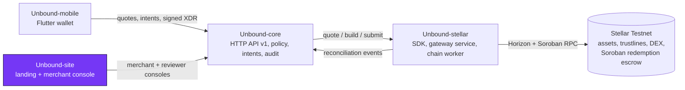

<div align="center">


# Unbound-site

**The Unbound landing page, merchant console and reviewer console, plus the GitBook source for the whole project.**

[](https://github.com/Unbound224/Unbound-site/actions/workflows/ci.yml)
[](./LICENSE)
[](https://developers.stellar.org/docs/networks)
[](#tech-stack)

[Live site](https://unbound-web1.vercel.app) · [Docs](https://github.com/Unbound224/Unbound-site/tree/main/gitbook) · [Quick start](#quick-start) · [Architecture](./docs/ARCHITECTURE.md) · [Contributing](./CONTRIBUTING.md)

<p>
  
  
</p>

</div>

## What this is

Store credit is usually stuck inside one retailer. Unbound lets a person exchange store credit that a retailer has issued and
agreed to honor for other Stellar assets, at a real order-book quote that they sign on their own device, or redeem it with the
issuer. This repository is the web face of that system. It has three parts:

- **Landing page.** The value proposition, an animated diagram of issuer, credit, exchange and redemption escrow, an interactive
  quote explainer, the Android download, and a FAQ. Light and dark themes, responsive down to 360 px, animations off under
  `prefers-reduced-motion`.
- **Merchant console** (`/merchant`). Sign in against `Unbound-core`, see verified credit programs and the redemption queue with escrow
  state and deadline, confirm or reject with a reason, and reply to disputes. Escrow actions hand you the unsigned transaction to sign
  with your issuer key (Freighter or a pasted signed envelope).
- **Reviewer console** (`/admin`). The issuer review queue (verify with an evidence reference, revoke with a reason), disputes, and the
  maintenance jobs with run-now.

It never builds or signs Stellar transactions on its own, never asks for a secret key, and keeps the session token in memory only.
The project's documentation source lives in [`gitbook/`](https://github.com/Unbound224/Unbound-site/tree/main/gitbook) and is published with GitBook.

Unbound is a Testnet prototype. It has had no security audit and holds no real funds.

## Status

| Piece | State |
|---|---|
| Landing page, light and dark themes, reduced motion, config-driven store badges | Live at [`unbound-web1.vercel.app`](https://unbound-web1.vercel.app) |
| Merchant console against the hosted core | Live: calls go through this site's `/core` proxy to `https://unbound-core.onrender.com` (free Render instance: sleeps when idle, data resets on redeploy) |
| Click-through on 2026-11-04 against a running core with Testnet data | Merchant console showed three real escrow redemptions in their final states; reviewer console listed the issuer queue and jobs; password-reset pages worked |
| Typed API client (zod-validated); every endpoint checked against core's OpenAPI fixture | Built and tested |
| Accessibility | axe-core checks on every page and state; a manual screen-reader audit is not done |
| Escrow confirm and reject signed with the Freighter browser wallet (fail closed: must be the credit issuer's account, on Testnet) | Built and tested with a mocked wallet; **not tried with a real Freighter install** |
| Admin sign-in with a one-time code when MFA is on | Built and tested; there is no MFA enrolment screen yet |
| Android download button | Points at `releases/latest/download/unbound-android.apk` of [Unbound-mobile](https://github.com/Unbound224/Unbound-mobile/releases) |
| Issuing credit from the UI, policy-signing helper, browser end-to-end tests in CI, Lighthouse budgets | Not built |
| Official store badges | Not shown: there are no store listings |

## How it fits together



| Repository | Owns | CI |
|---|---|---|
| [Unbound-core](https://github.com/Unbound224/Unbound-core) | Backend API: issuers, policies, intents, redemptions, audit | [](https://github.com/Unbound224/Unbound-core/actions/workflows/ci.yml) |
| [Unbound-stellar](https://github.com/Unbound224/Unbound-stellar) | Stellar SDK, gateway service, chain worker, Soroban escrow | [](https://github.com/Unbound224/Unbound-stellar/actions/workflows/ci.yml) |
| [Unbound-site](https://github.com/Unbound224/Unbound-site) (this repo) | Landing page, consoles, GitBook source | [](https://github.com/Unbound224/Unbound-site/actions/workflows/ci.yml) |
| [Unbound-mobile](https://github.com/Unbound224/Unbound-mobile) | Flutter consumer wallet | [](https://github.com/Unbound224/Unbound-mobile/actions/workflows/ci.yml) |

The escrow contract this site's console talks to is
[`CC4ETHM4...YOP6C` on Stellar Expert](https://stellar.expert/explorer/testnet/contract/CC4ETHM44IUJ4GDRT57VH4OSNEMPEGUKQHQJCUQDIU2LKIAKZYIYOP6C).

## Tech stack

| Layer | Choice |
|---|---|
| Framework | Next.js 16 (App Router), React 19, TypeScript |
| Styling | Tailwind CSS 4, light and dark themes |
| Validation | zod |
| Wallet | `@stellar/freighter-api`, fail-closed adapter |
| Tests | Vitest with Testing Library and axe-core; a live-core test that spawns a real `Unbound-core` |
| Hosting | Vercel (this site); core and gateway on Render free instances |

## Quick start

Requires Node 22+.

```bash
npm ci
cp .env.example .env.local         # NEXT_PUBLIC_API_URL=/core, CORE_PROXY_TARGET=http://127.0.0.1:3001
npm run dev                        # http://localhost:3000
npm run check                      # lint + typecheck + tests + production build
```

The landing page works on its own. For the merchant console, run a seeded
[Unbound-core](https://github.com/Unbound224/Unbound-core#quick-start) on port 3001 and sign in with the seeded merchant. Core sends no CORS
headers, so the browser calls this site's `/core/*` route, which Next proxies to `CORE_PROXY_TARGET`. `NEXT_PUBLIC_*` values are baked in at
build time, so changing one needs a new build.

Store badges are config-driven: official badges render only when `NEXT_PUBLIC_APP_STORE_URL` or `NEXT_PUBLIC_PLAY_STORE_URL` is an https URL on
`apps.apple.com` or `play.google.com`. Without them the page shows **Download for Android (beta APK)** and an inert **iOS, coming soon**. A test
checks that no store links render without the variables.

## Project structure

```text
src/app/            routes: landing, /merchant, /admin, password reset pages
src/components/     landing sections, consoles, escrow sign panel
src/lib/            typed API client, Freighter adapter, session, site config
tests/              component, accessibility, API client and live-core tests
gitbook/            GitBook documentation source (published with GitBook Git Sync)
docs/               architecture, security, deployment, screenshots
brand/              logo, tokens, org avatar
```

## Contributing

Pick a [Stellar Wave issue](https://github.com/Unbound224/Unbound-site/issues?q=is%3Aopen+label%3A%22Stellar+Wave%22). Each has a
complexity label (`trivial`, `medium`, `high`), scope, implementation notes and acceptance criteria. Read [`CONTRIBUTING.md`](./CONTRIBUTING.md),
comment on the issue to claim it, and open a PR with `npm run check` green. Everyone follows the [Code of Conduct](./CODE_OF_CONDUCT.md).

## Security

Unaudited, Testnet only. Never use real funds or Mainnet keys with this code. Report vulnerabilities privately through the
[Security tab](https://github.com/Unbound224/Unbound-site/security); see [`SECURITY.md`](./SECURITY.md) and the threat model in
[`docs/SECURITY.md`](./docs/SECURITY.md).

## Community

Questions and ideas: [GitHub Discussions](https://github.com/Unbound224/Unbound-site/discussions).

## Maintainers

| Maintainer | Role |
|---|---|
| [@Cjay-Cyber-2](https://github.com/Cjay-Cyber-2) | Project lead and maintainer, [Unbound224](https://github.com/Unbound224) |

## Contributors

<a href="https://github.com/Unbound224/Unbound-site/graphs/contributors">
  
</a>

## License

[MIT](./LICENSE). The Unbound logo in [`brand/`](./brand) is the project's identity; it has not been trademark-cleared.
