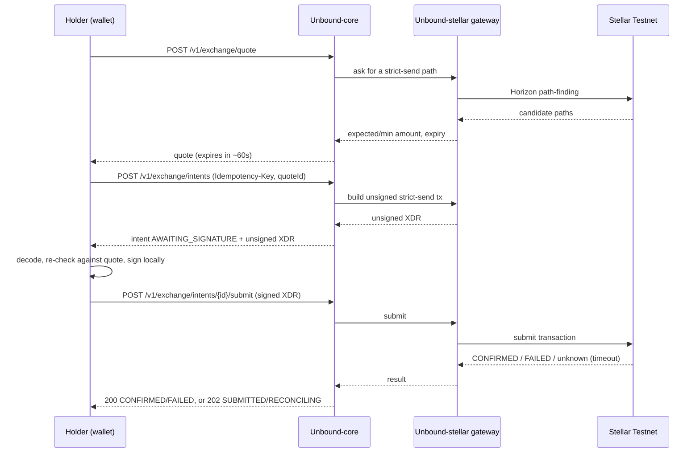
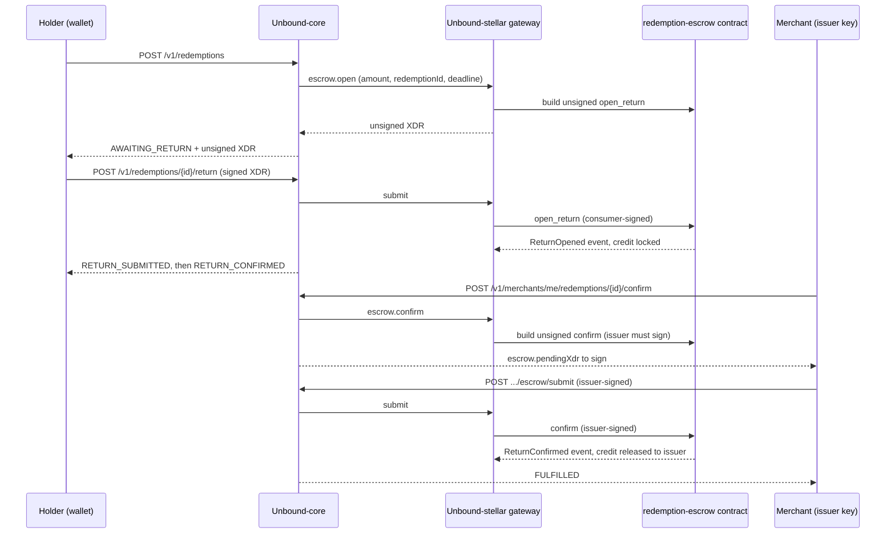
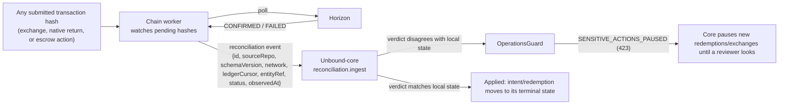

# Data flow

This page traces one request of each kind end to end through the real services, so it's clear which repository does what and where the ledger becomes the source of truth.

## Exchange: quote → intent → submit → settle

If the result is unknown (a lost response, not a ledger rejection), the intent becomes `RECONCILING`. The chain worker is watching the same transaction hash against Horizon independently and reports the verdict back to core as a reconciliation event — this is why a lost HTTP response never needs a blind retry.

## Redemption (escrow mode): return → hold → issuer decision

The same diagram with `reject` instead of `confirm` refunds the holder on-chain instead; if the merchant never responds, the holder calls `POST /v1/redemptions/{id}/refund` after the deadline instead of waiting on the merchant, and anyone's signed `expire_refund` closes it.

## Reconciliation path (the one that catches everything else)

This is the one path every state machine in Unbound ultimately depends on: nothing becomes `CONFIRMED`, `FULFILLED`, `REJECTED` or `EXPIRED` without either an immediate ledger verdict at submit time, or a later reconciliation event carrying the same thing. A discrepancy — the ledger saying one thing while core's database says another — never resolves itself silently; it pauses sensitive actions and waits for a human. See [Failure modes and recovery](failure-modes.md).
