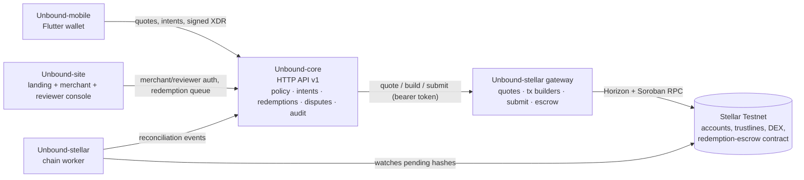

# Architecture overview

Unbound is four independently deployable repositories, each owning a distinct engineering domain. This split is deliberate (see `docs/ARCHITECTURE.md` in Unbound-core and Unbound-stellar, which is the same document in both repos) and is not to be broken up further just to create more Wave issues.

## The four repositories

| Repository | Owns | Built with | Consumers |
|---|---|---|---|
| [Unbound-core](https://github.com/Unbound224/Unbound-core) | Merchant onboarding, signed redemption policies, exchange intents, redemptions, disputes, accounts, audit trail — the system of record | TypeScript / Node 22, a small `node:http` router, SQLite behind a `Storage` port | Unbound-site, Unbound-mobile |
| [Unbound-stellar](https://github.com/Unbound224/Unbound-stellar) | Everything that touches the ledger: issuer/trustline checks, path quotes, unsigned transaction builders, the gateway HTTP service, the chain worker, the one Soroban contract | TypeScript SDK + Rust contract (`soroban-sdk` 29.0.1) | Unbound-core only |
| [Unbound-site](https://github.com/Unbound224/Unbound-site) | Public landing page, merchant console, reviewer console, and this GitBook source | Next.js 16 | End users (browser) |
| [Unbound-mobile](https://github.com/Unbound224/Unbound-mobile) | Consumer wallet: asset inventory, offers, secure signing, redemption status | Flutter | End users (phone) |

No repository reimplements another's job: the mobile app does not own merchant verification, core does not build or parse Stellar transactions, and the Stellar layer does not know anything about disputes or policies.

## Request flow

Clients (mobile, site) never build or sign a Stellar transaction themselves beyond the final user signature — core and the gateway build every unsigned transaction, and the ledger is the only source of settlement truth.

## Trust boundaries

| Boundary | What crosses it | What is checked at the boundary |
|---|---|---|
| Browser / mobile ↔ Unbound-core | Login credentials, wallet challenge signatures, bearer session tokens, quote/intent/redemption requests, `Idempotency-Key` headers | Role (`user`/`merchant`/`admin`), ownership of the resource, request schema (zod, strict mode), idempotency-key replay rules |
| Unbound-site ↔ Unbound-core | Same-origin proxy (`/core/*` → `CORE_PROXY_TARGET`) | Nothing extra — the browser never talks to core cross-origin, so core issues no CORS headers unless `CORS_ALLOWED_ORIGINS` is set |
| Unbound-core ↔ Unbound-stellar gateway | Quote requests, transaction build/submit requests, escrow open/confirm/reject/expire, trusted-asset sync | A static bearer token (`STELLAR_GATEWAY_TOKEN` / `GATEWAY_TOKEN`); the gateway refuses any asset not on its pushed trusted-asset list |
| Unbound-stellar gateway ↔ Stellar Testnet | Transaction submission, path/ledger reads | The ledger itself: signature verification, sequence numbers, time bounds, the strict-send minimum, and (for the escrow) contract-level `require_auth` checks |
| Chain worker ↔ Unbound-core | Reconciliation events | An admin session token obtained by the worker logging in; never stored |

Nobody outside a user's own device ever holds that user's secret key. Core never sees one; the gateway never sees one; the escrow contract only ever receives signed authorizations, never keys.

## What runs where today

| Service | Where | Notes |
|---|---|---|
| Unbound-core | Render (free instance) — `unbound-core.onrender.com` | Development entrypoint (`APP_ENV=development`); SQLite resets on redeploy; sleeps when idle |
| Unbound-stellar gateway | Render (free instance) — `unbound-gateway.onrender.com` | Bearer-token protected, not meant for public traffic |
| Unbound-site | Vercel — `unbound-web1.vercel.app` | Auto-deploys on push to `main` |

See [Deployment](../deployment.md) for exact commands and environment variables, and [Failure modes and recovery](failure-modes.md) for what happens when any one of these pieces disagrees with another.
