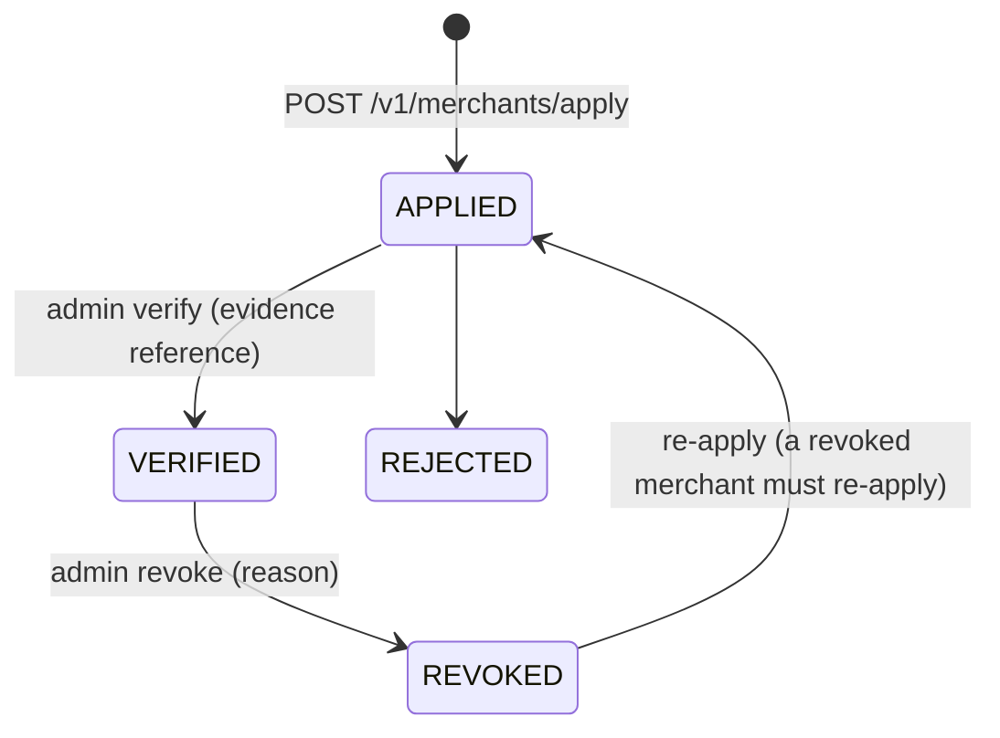

# Credit, issuers and policies

## What counts as credit

In Unbound, **credit** is a classic Stellar issued asset: a pair `(code, issuer)`. The code is 1 to 12 letters or digits. The issuer is a Stellar account that created the asset. Unbound adds no wrapper token.

A Stellar asset on its own proves nothing about a shop's willingness to redeem it. Unbound therefore treats an asset as usable only when four things are true:

1. A **merchant** registered a credit program for exactly that `(code, issuer)`.
2. The merchant is `VERIFIED` by a reviewer.
3. The merchant published a **redemption policy** signed by the issuer key, and the policy has not expired.
4. The program is `ACTIVE` (not suspended).

If any of these fails, the asset is **not eligible**. The API reports the reasons: `ASSET_UNKNOWN`, `PROGRAM_SUSPENDED`, `MERCHANT_NOT_VERIFIED`, `POLICY_EXPIRED`.

## Issuer flags

Unbound credits are issued with `AUTH_REQUIRED` and `AUTH_REVOCABLE` set on the issuer account. `AUTH_REQUIRED` means the issuer must authorize each holder's trustline before that holder can hold the asset. This is how an issuer controls who holds its credit. `AUTH_REVOCABLE` lets the issuer withdraw that authorization.

The SHOP test credit on Testnet has both flags. The check was done against Horizon (`auth_required: true`, `auth_revocable: true`) and is recorded in the [Stellar-layer deployment evidence](https://github.com/Unbound224/Unbound-stellar/blob/main/docs/DEPLOYMENT.md).

The escrow contract must also be authorized to hold the credit. That is a one-time `set_authorized` call on the asset's Stellar Asset Contract by the issuer. If the issuer has not done it, the escrow cannot take the credit, simulation fails, and core falls back to the native return payment.

## The redemption policy

The policy is a JSON document. It is the issuer's written promise, and it is signed.

| Field | Type | Meaning |
|---|---|---|
| `schemaVersion` | `"1.0"` | Only this version is accepted |
| `legalIdentity.legalName` | string, 2 to 200 | Who the issuer is |
| `legalIdentity.registrationRef` | string, 1 to 100 | A registration reference |
| `assetCode` | 1 to 12 alphanumerics | Must equal the program's asset code |
| `issuerPublicKey` | Stellar public key | Must equal the program's issuer |
| `unitOfAccount` | string, 2 to 100 | For example `1 SHOP = 1 USD of store credit` |
| `faceValue.amountPerUnit` | decimal with up to 7 places | Face value of one unit |
| `faceValue.currency` | three capital letters | For example `USD` |
| `redemptionLimits.minUnits` | optional decimal | Smallest redemption |
| `redemptionLimits.maxUnitsPerRequest` | optional decimal | Largest single redemption |
| `expiresAt` | ISO 8601 date-time | After this the credit is not eligible |
| `jurisdiction` | string | Governing jurisdiction |
| `refundPolicy` | string, 5 to 2000 | What happens to rejected redemptions |
| `contact` | string | Where a holder reaches the merchant |
| `kycRequirements` | string | Any identity requirement |
| `tokenizationAuthorized` | literal `true` | The issuer permits tokenization |
| `transferAllowed` | literal `true` | The issuer permits transfer |
| `signature` | base64 | Ed25519 signature by the issuer key |

The policy is strict. Unknown fields are rejected.

### How it is signed

The signature covers the **canonical JSON** of the policy without the `signature` field. Canonical JSON means keys sorted recursively, no whitespace, and `undefined` values dropped. The signature is Ed25519 by the issuer key over the UTF-8 bytes, base64 encoded.

A working implementation lives in the [core source](https://github.com/Unbound224/Unbound-core).

### What validation checks

Core validates in one pure function. Every problem it finds is reported, and any problem blocks activation.

| Problem | Meaning |
|---|---|
| `SCHEMA_INVALID` | The document does not match the schema |
| `SIGNATURE_INVALID` | The signature does not verify under the issuer key |
| `ISSUER_KEY_MISMATCH` | The policy's issuer is not the program's issuer |
| `ASSET_CODE_MISMATCH` | The policy's asset code is not the program's asset code |
| `EXPIRED` | `expiresAt` is in the past |
| `LIMITS_INCONSISTENT` | `minUnits` is greater than `maxUnitsPerRequest` |

## Merchant lifecycle

A merchant account is separate from a merchant record.

Verification requires an **evidence reference**: a ticket or document id. The system stores the reference and never the evidence. When a reviewer revokes a merchant, **every credit program of that merchant is suspended immediately**.

## Program lifecycle

A program is `ACTIVE` when registered by a verified merchant with a valid policy. It becomes `SUSPENDED` when its merchant is revoked.

## Swap targets

A holder can exchange credit for another Stellar asset. Those assets are not credit and are not redeemable. A reviewer adds them as **supported targets** (`POST /v1/admin/targets` with a code and issuer). The target list is public at `GET /v1/targets`. Credit and targets are both given to the gateway as trusted assets, so the gateway can quote and build transactions for both.

