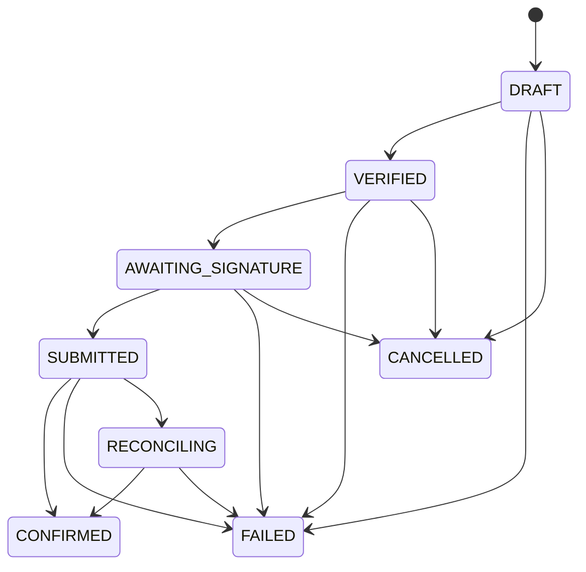

# Exchange intents

An **exchange intent** is the server-side record of one swap from a holder's credit to a target asset. It moves through a fixed set of states, and only ledger evidence can finish it.

## States

| State | Meaning |
|---|---|
| `DRAFT` | Created, not yet checked |
| `VERIFIED` | Quote and holder verified |
| `AWAITING_SIGNATURE` | An unsigned transaction exists. The holder must sign |
| `SUBMITTED` | The signed transaction was sent. The outcome is not yet known |
| `RECONCILING` | The outcome is unknown (timeout, lost response). Resolved only by a ledger verdict |
| `CONFIRMED` | The ledger confirmed the transaction. Terminal |
| `FAILED` | The ledger rejected it, or it never applied. Terminal |
| `CANCELLED` | The holder cancelled before submitting. Terminal |

## Transitions



These are the exact transitions the code allows. Any other transition is refused with `INVALID_STATE` (HTTP 409).

Three rules hold the model together:

- `SUBMITTED` never goes back. Once a transaction was sent, the only exits are a ledger verdict or `RECONCILING`.
- `RECONCILING` resolves only to `CONFIRMED` or `FAILED`, and only because the ledger said so.
- A chain-confirmed settlement that arrives for an intent already marked `FAILED` is **not** a transition. It is a **discrepancy**, and core pauses sensitive actions.

## Quotes

A quote is an indicative, expiring promise from the gateway.

| Field | Meaning |
|---|---|
| `quoteId` | Opaque id, for example `q_7dae6608bb3877f0ba52d067f39b2e95` |
| `sourceAsset`, `targetAsset` | The pair |
| `sourceAmount` | What the holder sends |
| `expectedDestinationAmount` | The best path's estimate |
| `minDestinationAmount` | The floor the ledger enforces |
| `slippageBps` | Allowed slippage in basis points |
| `path` | Intermediate assets, empty for a direct route |
| `estimatedFeeStroops` | Estimated network fee |
| `routesConsidered` | How many paths the gateway compared |
| `issuedAt`, `expiresAt` | Quote lifetime |
| `warnings` | Human-readable cautions, such as thin liquidity |

### The floor, with numbers

The floor is computed in integers:

```text
minDestinationAmount = expectedDestinationAmount * (10000 - slippageBps) / 10000
```

For the quote captured from core's real HTTP server (labeled fake gateway, rate 9/10, 100 bps slippage):

```text
expected = 80.0000000 * 9 / 10        = 72.0000000
minimum  = 72.0000000 * 9900 / 10000  = 71.2800000
```

For the live Testnet exchange (DEX offer at 1:1, 100 bps slippage):

```text
expected = 5.0000000
minimum  = 5.0000000 * 9900 / 10000   = 4.9500000
```

Both values match the recorded responses. The transaction is a strict-send path payment with the minimum as its destination minimum, so the ledger itself rejects the swap if the output would be lower. The app never has to trust the quote's arithmetic: the wallet re-derives the floor from the source amount and slippage before it signs.

### Amounts

All amounts are strings with exactly 7 decimal places, for example `"80.0000000"`. The base unit is a stroop: 1 unit equals 10,000,000 stroops. Amounts never pass through floating point. The maximum is 9,223,372,036,854,775,807 stroops.

## Idempotency

`POST /v1/exchange/intents` and `POST /v1/exchange/intents/{id}/submit` require an `Idempotency-Key` header of 8 to 128 characters.

- The same key with the same request returns the same intent.
- The same key with a different request returns `IDEMPOTENCY_CONFLICT` (HTTP 409).

The captured example: creating an intent with key `idem-key-0001` twice returned the same `AWAITING_SIGNATURE` intent both times.

## Submit and its three answers

`POST /v1/exchange/intents/{id}/submit` takes the signed transaction. It returns:

| HTTP | State | Meaning |
|---|---|---|
| 200 | `CONFIRMED` or `FAILED` | The ledger decided |
| 202 | `SUBMITTED` or `RECONCILING` | In flight. Poll the intent or wait for reconciliation |

It never reports success on its own. An honest "I do not know yet" is a 202.

## Live evidence

An exchange of 5 SHOP for USDC ran through core and the gateway against Testnet and reached `CONFIRMED`: transaction [`5879422d5f…`](https://stellar.expert/explorer/testnet/tx/5879422d5f67f3388f26f525a7cadaa9640eaa1c521fed272de3fc3dfbe775e1) at ledger 5557552. One known gap: `amountOutActual` stays `null` when an intent is confirmed synchronously at submit.

