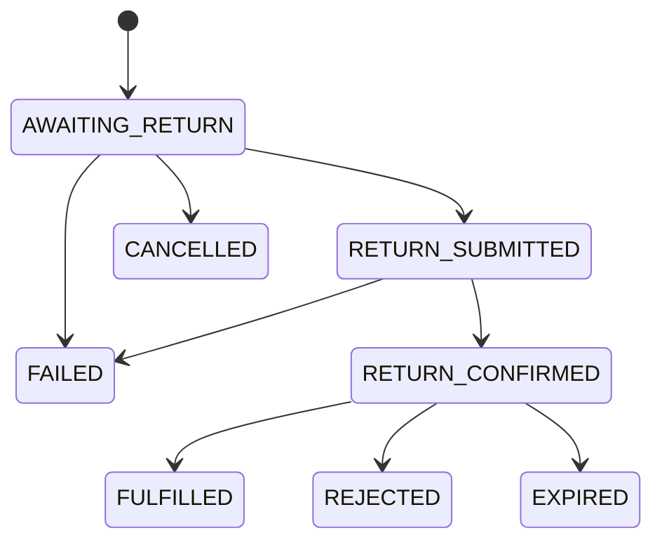

# Redemption lifecycle

A **redemption** is a holder returning eligible credit to its issuer. Unlike an exchange, a redemption ends with the issuer deciding, not with a DEX fill. The state machine below is copied from `RedemptionState` and the `NEXT` transition table in `Unbound-core/src/modules/redemption/service.ts`.

## States

| State | Meaning |
|---|---|
| `AWAITING_RETURN` | Created. An unsigned return transaction exists (native payment or escrow `open_return`); the holder must sign it. |
| `RETURN_SUBMITTED` | The signed return was sent. The ledger outcome is not yet known. |
| `RETURN_CONFIRMED` | The ledger confirmed the return. The credit is now with the issuer (native) or locked in the escrow (escrow mode), waiting for the merchant. |
| `FULFILLED` | Terminal. The merchant confirmed. Native: credit was already burned on arrival. Escrow: the issuer-signed `confirm` call released the credit to the issuer. |
| `REJECTED` | Terminal. The merchant rejected. Native: `refundDue: true`, settled off-chain or through a dispute. Escrow: the issuer-signed `reject` call already refunded the holder on-chain, so `refundDue: false`. |
| `EXPIRED` | Terminal, escrow mode only. The merchant never answered; the holder (or anyone) triggered the timeout refund after the deadline. |
| `FAILED` | Terminal. The return transaction itself failed on the ledger (for example a minimum-output or balance failure). |
| `CANCELLED` | Terminal. Reserved for a holder cancelling before submitting; the listed transition exists but no endpoint exposes it yet. |

## Transitions

Any transition not in this table is refused with `INVALID_STATE` (HTTP 409) — the same `NEXT` table the code checks on every move, so the diagram cannot drift from the implementation.

## NATIVE vs. ESCROW mode

Every redemption picks a `mode` when it is created, recorded on the record and never changed afterwards:

| | **NATIVE** | **ESCROW** |
|---|---|---|
| Return transaction | A plain Stellar payment to the issuer. Classic Stellar burns an asset paid to its own issuer on arrival. | `open_return` on the redemption-escrow contract. Credit moves into the contract, not to the issuer. |
| Confirm | Marks `FULFILLED`. Nothing further happens on-chain (the credit was already burned). | Builds the issuer-signed `confirm` invocation (`escrow.pending`); `FULFILLED` follows once that transaction confirms. |
| Reject | Marks `REJECTED`, `refundDue: true`. The merchant must refund the holder off-chain or through a dispute. | Builds the issuer-signed `reject` invocation; the contract refunds the holder on-chain, so `refundDue: false`. |
| No answer | No contract to time out; stays `RETURN_CONFIRMED` until a human acts or a dispute is opened. | After the deadline, the holder calls `POST /v1/redemptions/{id}/refund`, which builds the `expire_refund` invocation anyone may submit. |
| When used | Default fallback: used whenever the escrow is unavailable, the issuer has not authorized the escrow on its asset's SAC, or the escrow is paused. | Used when `STELLAR_ESCROW_ENABLED=true`, the gateway exposes an escrow, and `open_return` can simulate successfully. |


Core picks the mode automatically at creation time and falls back silently from ESCROW to NATIVE on any `ESCROW_*` gateway refusal (see [ADR 0002](https://github.com/Unbound224/Unbound-stellar/blob/main/docs/adr/0002-soroban-redemption-escrow.md)). The choice is recorded on the redemption (`mode`) so a client always knows which rules apply.


## Escrow sub-state

While a redemption is `RETURN_CONFIRMED` in escrow mode, core also tracks an `EscrowInfo` with its own `state`:

| Escrow state | Meaning |
|---|---|
| `AWAITING_OPEN` | The `open_return` transaction was built but not yet confirmed. |
| `HELD` | `open_return` confirmed; the credit is locked in the contract. |
| `RELEASED` | `confirm` confirmed; the credit went to the issuer. |
| `REFUNDED` | `reject` confirmed; the credit went back to the holder. |
| `EXPIRED_REFUNDED` | `expire_refund` confirmed after the deadline; the credit went back to the holder. |

A `pending` field appears whenever an issuer- or holder-signed escrow transaction has been built but not yet confirmed (`action: CONFIRM | REJECT | EXPIRE`, plus the hash and unsigned XDR to sign).

## Reconciliation and jobs

- The `reconcile-escrows` job (every 2 minutes) reads the contract for every `RETURN_CONFIRMED` escrow redemption and applies any close made outside core (for example, someone calling `expire_refund` directly). A redemption the contract no longer recognizes is flagged as a `DISCREPANCY`.
- Any confirmed ledger observation for a redemption's return or escrow-close hash is applied through `onObservation`; an observation that disagrees with the locally recorded state is also a `DISCREPANCY`, never silently overwritten.
- `claimRefund` and `merchantConfirm`/`merchantReject` are themselves idempotent: calling them again after the terminal state is reached returns the same result rather than erroring.
