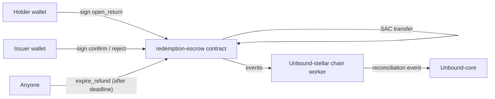

# Contract overview

Unbound uses exactly one Soroban contract: **`redemption-escrow`**, in `Unbound-stellar/contracts/redemption-escrow`. Everything else — issuing credit, trustlines, exchanging assets — is classic Stellar (accounts, trustlines, path payments). The decision to add this one contract, and only this one, is recorded in [ADR 0002](https://github.com/Unbound224/Unbound-stellar/blob/main/docs/adr/0002-soroban-redemption-escrow.md).

## Why a contract was needed at all

A holder returning credit to redeem it needs a three-way outcome: the issuer confirms (fulfilled), the issuer rejects (refund), or nobody answers in time (refund). Classic Stellar has no primitive for that:

- A plain payment to the issuer **burns the credit on arrival** (an issuer receiving its own asset destroys it), so a merchant that then rejects or stays silent leaves the holder with nothing on-chain — only an off-chain refund promise.
- A **claimable balance** comes close but has claimants and predicates fixed at creation: the issuer could claim at any time before the deadline without confirming anything, a rejection can't return funds early, and there's no single-use redemption id or record of the outcome.
- A **pre-signed transaction or multisig escrow account** would require Unbound to hold or co-sign keys, which the project's rules forbid (Unbound never custodies user funds).

So the contract exists to express "hold these funds; release to the issuer if the issuer confirms before time T, refund the consumer if the issuer rejects at any time, or refund the consumer automatically once T passes" — conditional custody with three exits.

## What the contract is, in one paragraph

A single Soroban contract (Rust, `soroban-sdk = 29.0.1`, target `wasm32v1-none`, under 400 lines including documentation) that holds **classic Stellar credit**, not a wrapped token. It moves the asset through the asset's own **Stellar Asset Contract (SAC)** token interface, so a redemption escrowed by this contract is still the same `(code, issuer)` asset a holder already trusted — there is no new Unbound-issued token anywhere in the system.

## Scope and non-goals

| In scope | Out of scope |
|---|---|
| Holding one issuer's returned credit per redemption, keyed by a single-use id | Exchanging assets (that's classic path payments) |
| Three exits: issuer confirm, issuer reject, anyone-after-deadline expire | Any other business logic (policy validation, disputes, accounts) — all of that stays in `Unbound-core` |
| A pause switch that blocks **new** opens only | Pausing or reversing an already-open return |
| Read-only getters for a return and a token's locked total | An audit; this contract is unaudited and Testnet-only |

## How the pieces fit

`Unbound-core` never calls the contract directly. It goes through its `StellarGateway` port (`gateway.escrow`), which `Unbound-stellar`'s gateway service implements with the real Soroban RPC adapter. If that adapter is unreachable, not configured, or the issuer hasn't authorized the escrow on its asset's SAC, core falls back to the plain native return payment — unchanged behavior from before the contract existed.

See [Contract functions](functions.md) for every public entry point, [Errors and events](errors-and-events.md) for the full error and event list, and [Build, test, deploy](build-test-deploy.md) for how to compile, test and deploy it yourself.


**Unaudited, Testnet only.** This contract has not had an external security audit. The real deployment evidence (contract id, wasm hash, transaction hashes) is in [Testnet evidence](../testnet-evidence.md).

