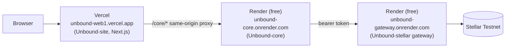

# Deployment

Unbound's hosted footprint today is three free-tier services across two providers. Nothing here is production-grade, and every page that mentions it says so.

## Topology



| Service | Provider | Plan | URL |
|---|---|---|---|
| Unbound-site | Vercel | Free | `https://unbound-web1.vercel.app` |
| Unbound-core | Render | Free (web service) | `https://unbound-core.onrender.com` |
| Unbound-stellar gateway | Render | Free (web service) | `https://unbound-gateway.onrender.com` |


The owner does not touch the Render or Vercel dashboards directly as part of routine work; Vercel redeploys itself automatically on every push to `main`.


## Unbound-site on Vercel

Vercel auto-detects the Next.js build; there's no custom `vercel.json` in the repo. Production environment variables, both public (from `docs/DEPLOYMENT.md`):

| Variable | Value |
|---|---|
| `NEXT_PUBLIC_API_URL` | `/core` |
| `CORE_PROXY_TARGET` | `https://unbound-core.onrender.com` |

`next.config.ts` reads `CORE_PROXY_TARGET` at **build** time to construct the `/core/*` rewrite rule — changing that variable requires a new build, not just a restart.

## Unbound-core and the gateway on Render

Both are plain Render web services (no `render.yaml` blueprint in either repo — they're configured directly in the Render dashboard, which per project rules is not something an automated agent touches). Build and start commands match each repo's own `package.json`:

```bash
# Unbound-core
npm ci && npm run build
npm start

# Unbound-stellar gateway
npm ci && npm run build
npm run gateway
```

Required environment variables for the hosted core instance: `APP_ENV=development` (core refuses to start in anything else — there is no hardened production mode), `STELLAR_NETWORK=testnet`, and whatever subset of [the environment variable tables](development/environment-variables.md) the deployment needs (for example `STELLAR_GATEWAY_URL` pointing at the Render gateway URL, `STELLAR_GATEWAY_TOKEN` matching the gateway's `GATEWAY_TOKEN`).

## Free-plan limits that actually bite

These are disclosed on the live site's own [Try it](getting-started/try-it.md) page and status tables, not hidden:

- **Render free instances sleep when idle.** The first request after a pause can take 50 seconds or more.
- **Core's SQLite data resets on every redeploy.** There's no managed Postgres or persistent volume in this topology — `DATABASE_FILE` points at ephemeral local disk on Render's free tier.
- **The gateway is not meant for public traffic.** It's bearer-token protected (`GATEWAY_TOKEN`/`STELLAR_GATEWAY_TOKEN`); hitting it without the token returns 401.
- **No horizontal scaling.** A single free instance each; this setup is for demonstrating the prototype, not for load.

## What a real production deployment would need

Per `docs/DEPLOYMENT.md` in both backend repos, moving beyond this: a managed Postgres (the suggested `DATABASE_URL` in the env tables is forward-looking, not yet wired up), a persistent Redis if queues are added, a real secret manager for signing identities, branch protection and required PR review (recommended, not yet enforced as a hosting prerequisite), and — before any Mainnet or real-funds use — a security audit and jurisdictional legal/compliance review. None of that exists today; this is a Testnet prototype deployment only.
